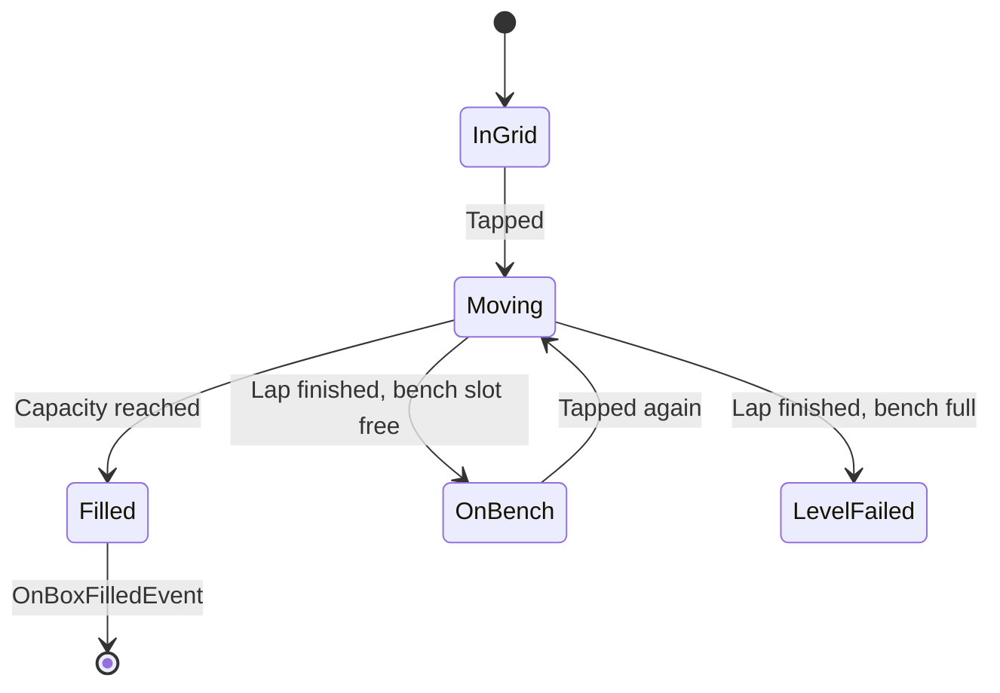
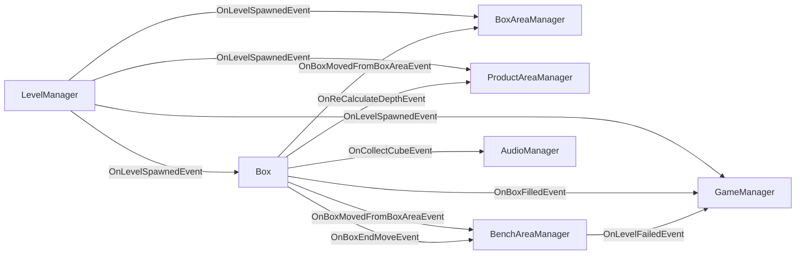

<div align="center">

# 📦 Rovio Case — Unity

A mobile-style color-sorting puzzle built in Unity (C#), featuring an event-driven architecture, spline-based box movement, object pooling, and a data-driven level system powered by ScriptableObjects.


https://github.com/user-attachments/assets/b15fad8b-5a48-4e24-8882-f66c59978cf2


</div>

## 🎮 About

A tap-to-play puzzle where colored boxes ride a conveyor loop around a pixel-art grid of cubes, collecting every cube that matches their color. Fill every box before the bench runs out of space.

The project focuses on clean, decoupled architecture: gameplay systems communicate through a lightweight typed EventBus, levels are described entirely by ScriptableObjects, and frequently spawned objects (cubes, grid nodes, particles) are recycled through an object pool.

New levels, colors, and box capacities can be created without touching the core gameplay code.

## ✨ Features

- 👆 One-tap touch controls using the Input System's `EnhancedTouch`.
- 🌀 Boxes travel along a Unity Spline and collect cubes from the outer layers of the grid.
- 🎨 Color-matched collection: a box only picks up cubes of its own color.
- 🔢 Per-box capacity with live `current/max` counters.
- 🪑 Limited bench for boxes that finish a lap without being filled.
- 🔓 Smart box availability: only reachable boxes are clickable, while the rest are visually dimmed.
- 🗺️ Data-driven levels (grid contents, box colors, capacities) via ScriptableObjects.
- 💾 Level progress saved with `PlayerPrefs`; levels loop when the list ends.
- ♻️ Generic object pool for cubes, grid nodes, and particle effects.
- 🎬 Polished feedback with DOTween (squash & stretch, arcing cube flight, fill celebration).
- 📳 Haptic feedback via Nice Vibrations.
- 🔊 Collect sound with a pitch that ramps up during fast collection streaks.
- 📡 Generic, type-safe EventBus for decoupled communication.

## 🕹️ Gameplay

### Controls

| Action | Input |
|---|---|
| Send a box onto the conveyor | Tap the box |

### Game Rules

1. The board has a product area (a grid of colored cubes) and a box area (a 3×3 grid of colored boxes).
2. Tapping a box makes it jump onto the conveyor spline that circles the cube grid.
3. While moving, the box scans the grid and collects matching cubes from the outermost layer facing it.
4. A box that reaches its capacity is filled, plays a celebration animation, and disappears.
5. A box that completes the loop without being filled is moved to the bench.
6. Boxes on the bench can be tapped again to run another lap.
7. A box is only tappable if it is in the front row or has a free neighboring cell. Blocked boxes are dimmed.
8. If a box finishes its lap and no bench slot is free, the level is failed.
9. Filling every box completes the level.
10. After winning or losing, a result panel appears with Next / Retry buttons.

### Levels

The project ships with 5 sample levels using a 25×25 cube grid. Some levels use empty cells to form shapes and an empty box cell to act as an obstacle. Box capacities are tuned so the total capacity matches the number of cubes on the board.

## 🧠 How It Works

### Cube Collection

The product grid is analyzed from four directions (Up, Right, Down, Left). For each direction, the system keeps a list of depth columns: the first cube each column exposes to a passing box.

As a box moves along the spline:

1. Its facing direction is derived from its rotation.
2. A raycast to its side detects the nearest cube on the cube layer.
3. If that cube is the first one exposed in its column and matches the box color, it flies to the box in an arc.
4. The column is locked for that pass so a single column is not drained twice.
5. When the box turns a corner, locked columns are cleared and the depth data is recalculated through an event.

### Box Lifecycle



### Box Availability

A box is clickable when:

- It sits in the front row of the box grid, or
- At least one of its four neighbors is in bounds, not an obstacle, and empty.

Availability is recalculated every time a box leaves the grid.

## 🏗️ Architecture

Gameplay systems communicate through typed events rather than referencing each other directly.

### Event Flow



### Events

| Event | Raised When |
|---|---|
| `OnLevelSpawnedEvent` | A level is (re)built. Managers reset and rebuild their grids. |
| `OnBoxMovedFromBoxAreaEvent` | A box is tapped and leaves its cell (or bench slot). |
| `OnBoxEndMoveEvent` | A box finishes its lap without being filled. |
| `OnReCalculateDepthEvent` | The exposed cube columns need to be recomputed. |
| `OnCollectCubeEvent` | A cube lands inside a box. |
| `OnBoxFilledEvent` | A box finishes its fill animation. |
| `OnLevelFailedEvent` | A box finishes a lap and the bench is full. |

### Core Systems

| System | Responsibility |
|---|---|
| `GameManager` | Holds the `Idle` / `Play` state, counts filled boxes, handles win/lose, haptics, and level progression. |
| `LevelManager` | Picks the current `LevelDesignData`, updates the level label, and spawns levels (Next / Retry). |
| `BoxAreaManager` | Builds the 3×3 box grid, spawns boxes and obstacles, and updates clickable states. |
| `ProductAreaManager` | Builds the cube grid and maintains the four directional depth columns. |
| `BenchAreaManager` | Tracks free bench slots, parks unfilled boxes, and raises the fail event. |
| `Box` | Spline movement, color-matched cube collection, capacity tracking, and fill animation. |
| `Cube` | Color setup, flight animation toward a box, and collection particle effects. |
| `BoxSelecter` | Touch input, raycasting against `IClickable`, and tap cooldown. |
| `ObjectPool` | Named pools with automatic expansion. |
| `AudioManager` | Collect sound with a pitch that scales with collection intensity. |
| `SaveLoadManager` | Stores and reads the current level through `PlayerPrefs`. |
| `EventBus` | Generic, type-safe publish/subscribe. |

### Design Decisions

- **Struct events:** Events are lightweight structs implementing `IEvent`, carrying only the data listeners need.
- **Explicit lifecycle:** Every subscriber registers in `Start`/`Awake` and unsubscribes in `OnDestroy`.
- **Generic grid builder:** `Helpers.CreateGrid<TNode>` creates both the box grid and the cube grid, with callbacks for node creation and post-processing.
- **Object pooling:** Cubes, product nodes, and particles are recycled between levels instead of destroyed.
- **No per-object materials:** Colors are applied through `MaterialPropertyBlock`, keeping draw calls batch-friendly.
- **Game state gate:** Input and box movement only run while `GameState` is `Play`.
- **Tween cleanup:** Active DOTween animations are completed when a level ends to avoid leftover callbacks.
- **Interface-based input:** `IClickable` decouples touch handling from what is being tapped.

## 📂 Project Structure

```text
Assets/
└── Scripts/
    ├── Events/                # EventBus and event structs
    ├── Grid/                  # Box, Cube, grid nodes and bench area
    ├── Helpers/               # Enums, Singleton, grid and color helpers
    ├── Inputs/                # Touch input (BoxSelecter)
    ├── Interface/             # IClickable, IEvent
    ├── Managers/              # Game, Level, BoxArea, ProductArea, BenchArea, Audio, Save
    ├── ObjectPool/            # Pool, pooled particle and auto-disable helpers
    └── SO/                    # ScriptableObject definitions and assets
        ├── BoxProperties/     # Box speed, turn angle and cube layer
        ├── ColorProperties/   # Red / Blue / Green color definitions
        └── Levels/            # Level 1–5 data
```

## 🚀 Getting Started

### Requirements

- Unity 6 (6000.x)
- Unity Input System package
- Unity Splines package
- TextMeshPro
- DOTween
- Nice Vibrations (Lofelt)

### Installation

1. Clone the repository.
2. Open Unity Hub.
3. Select **Add → Add project from disk**.
4. Select the cloned project folder.
5. Import DOTween and Nice Vibrations if they are not included in the repository.
6. Open the main scene inside `Assets/Scenes/`.
7. Press Play to start the game.

> The game is designed for touch input. Use the **Device Simulator** in the Unity Game view, or build to a mobile device.

## ⚙️ Configuring Levels & Colors

### Level Configuration

Edit a `LevelDesignData` asset (**Create → ScriptableObjects → Level Design Data**) to configure:

- Cube grid size and node size.
- Cube colors per cell (including empty cells for pixel-art shapes).
- Box colors per cell in the 3×3 box grid (an empty cell becomes an obstacle).
- Box capacities.
- Box node, box, and obstacle prefabs.
- World offset of the box area.
- Available color properties.

Then add the asset to the `LevelManager`'s level list. Levels play in order and loop after the last one.

### Box Behavior

Edit the `BoxProperties` asset to tune:

- Conveyor speed.
- Turn angle threshold used to detect corners.
- Layer mask used to detect cubes.

### Colors

Each `ColorProperties` asset defines:

- The color identity (`Red`, `Blue`, `Green`).
- The box and cube material colors.
- The brightness offset applied when a box is not clickable.

#### Adding a New Color

1. Add a value to the `BoxColor` enum.
2. Create a new `ColorProperties` asset for it.
3. Add the asset to the level's color list.
4. Use the new color in the level's cube and box cells.

## 🧰 Tech Stack

| Area | Tool |
|---|---|
| Engine | Unity 6 |
| Language | C# |
| Animation | DOTween |
| Movement path | Unity Splines |
| Input | Unity Input System (`EnhancedTouch`) |
| UI | TextMeshPro |
| Haptics | Nice Vibrations |
